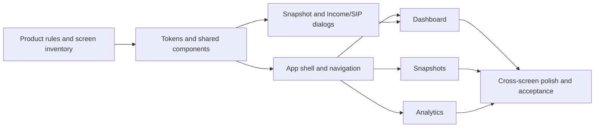

# FinDash application redesign plan

**Status:** redesign and consistency pass implemented; visual acceptance review remains
**References:** *Wealth Snapshot Apple-style redesign.pdf* (4 pages) and the [Claude canvas](https://claude.ai/artifact/Mm8LtihAZwgYZ67cZywB5W) with Dashboard / Snapshots / Analytics boards  
**Scope:** redesign the complete application around one shared design language. The snapshot editor will use that language too; page 1 of the PDF is a content/layout reference, not a separate visual system.

## 1. What the reference is asking the app to feel like

The PDF presents three destinations under one compact top navigation:

1. **Dashboard:** current net worth is the primary story, followed by a milestone/insight, a short row of supporting measures, wealth progression, allocation, and recent snapshots.
2. **Snapshots:** a dated, newest-first record list with notes, change, hard capital, market value, and unrealized gain. Filters and contextual prompts keep the list useful.
3. **Analytics:** net worth over a selected period, what changed (capital versus market movement), available liquidity, and portfolio returns.

The visual language is Swiss structure with Apple craft: a 12-column grid, flush-left type, a 2px ink rule above each section, a slim top bar, oversized tightly tracked figures, and tabular numerals. Warm paper is `#F4F2ED`; ultramarine `#2447F5` marks actions and the net-worth line. Asset colors stay fixed across the app, while green/red communicate financial gains/losses. Rounded color tiles and short, human microcopy add personality without turning every section into a card. The snapshot screen in the PDF uses a more native-sheet treatment; its content structure is useful, but its isolated styling should be replaced with the same application tokens and components used everywhere else.

## 2. Baseline before redesign

- The app already has Dashboard, Snapshots/History, and Analytics tabs in [App.tsx](../frontend/src/App.tsx), but navigation is a fixed left sidebar and range selection is global.
- The dashboard currently starts with six metric cards, then a bar chart/allocation panel and a compact recent-history table.
- The history table has pagination and edit actions. Its current columns differ from the design, and it has no note/movement filters.
- Analytics already calculates period net-worth change, capital versus market movement, available balances, per-asset XIRR, and a monthly heatmap.
- The snapshot editor already carries values forward, calculates a live net worth and previous-snapshot delta, and edits cash/deposit and market values. Income/SIP edits live in a second modal.
- Styling is mostly in one large [index.css](../frontend/src/styles/index.css). The editor has a separate block of hard-coded light/dark colors and sizing, which is the clearest source of visual drift.
- The app uses React, TypeScript, Tailwind, Chart.js, a local Go API, `data.json`, and browser `localStorage`. The plan keeps these data and runtime boundaries intact.
- The current `6M` filter removes entries earlier than the exact six-month cutoff. For period comparisons, the redesigned Analytics should also use the latest snapshot on or before that cutoff as its comparison anchor, and display that anchor's date.

## 3. Shared design language

Use the values below as the shared implementation tokens. Components should consume tokens; they should not define their own one-off colors, font sizes, or corner radii.

### Color tokens

| Token | Light target | Use |
| --- | --- | --- |
| `canvas` | `#F4F2ED` | Warm paper page background |
| `surface` | `#F4F2ED` | Default page surface; use rules instead of boxed sections |
| `surface-raised` | `#FFFFFF` | Dialogs, controls, small grouped surfaces |
| `ink` | `#111111` | Primary text and headline values |
| `ink-muted` | `#6B6860` | Descriptions, dates, supporting labels; contrast checked against paper |
| `rule` | `#DAD6CD` | Dividers and understated outlines |
| `action` | `#2447F5` | Primary action, selected navigation, net-worth line, mutual-fund asset |
| `positive` | `#0B7A43` | Positive movement and returns |
| `negative` | `#C62828` | Negative movement and returns |
| `notification` | `#D7263D` | Small actionable-pending dot on the notification bell only |
| `asset-stocks` | `#FF6A3D` | Stocks, consistently across chart and allocation |
| `asset-nps` | `#B58CFF` | NPS, consistently across chart and allocation |
| `asset-crypto` | `#E24C8B` | Crypto, consistently across chart and allocation |
| `asset-liquid` | `#1FB5A8` | Cash buffer; bank and Sodexo use distinct teal tints |
| `asset-other` | `#9A968C` | Other assets, consistently across chart and allocation |
| `finance-capital` | `#6B6860` | Hard-capital line and movement marker |
| `finance-market` | `#B8C4FF` | Unrealized-gain fill and movement marker |
| `attention` | `#FFD84D` | Goal tile and data-attention callouts only |
| `callout-warm` | `#FFE88A` | Informational concentration/insight callout |

Use matching dark tokens while preserving the same asset/semantic mapping. Keep gain/loss text colors for financial direction; application status/error messages use text, icons, and neutral/blue surfaces. Give chart strokes an outline where a fixed asset hue alone does not reach 3:1 contrast.

### Type, spacing, and shape

- Use SF system fonts on Apple platforms and Inter where available, with local system fallbacks elsewhere. Do not add a remote font dependency just to supply a font.
- Use a responsive type scale: display amounts 56–88px at `-0.04em`, large numerals 36–56px at `-0.035em`, h2 headings 28–34px at `-0.025em`, body 15–17px, and 12px uppercase eyebrows at `+0.08em` tracking.
- Use a small weight set: 400 body, 500 controls/secondary emphasis, 600 section and metric emphasis, 700 headline emphasis. Use tabular numerals for money, percentages, and dates.
- Use a 4px base spacing scale (`4, 8, 12, 16, 24, 32, 48, 64px`) and shared radius tokens of 12px controls, 20px surfaces, and 28px large callouts; segmented and action buttons stay pill-shaped.
- Use the 12-column grid and flush-left alignment throughout. Start each major section with a 2px ink rule. Favor whitespace and those rules over a card around every section; reserve rounded color tiles for a goal or an important callout. Use subtle elevation only for overlays and interactive floating controls.
- Set a shared content width around 1280px, fluid page gutters, and breakpoints for desktop, tablet, and narrow mobile. Charts and tables must have intentional compact layouts or horizontal overflow, not accidental clipping.

### Shared component set

Build or normalize reusable pieces before page styling: `AppShell`, segmented `PrimaryNav`, `PageHeader`, `Eyebrow`, `HeroMetric`, `MetricStrip`, `SectionRule`, `PrimaryButton`, `QuietButton`, `IconButton`, `SegmentedControl`, `CurrencyField`, `FormSection`, `DataTable`, `InsightCallout`, `SyncStatus`, and `Dialog`. Each component should use token variables and include hover, focus, disabled, empty, error, and dark-mode states where relevant.

Suggested code organization: put variables in `frontend/src/styles/tokens.css`; keep shared primitives in `frontend/src/components/ui/`; split shell, page, and dialog rules into styles owned by those areas; then import them in a clear order from `index.css` (tokens → primitives → shell → pages). Keep financial derivation in `frontend/src/utils/derive.ts` or small shared selectors, separate from presentational components. This gives each visual rule an owner and prevents a second page-specific styling system from growing beside the new one. Define one asset palette map and pass it to every chart, legend, allocation list, and trend tile.

## 4. Application hierarchy and chronology

Keep the same reading order on every destination:

**Where am I / what period is this? → primary wealth figure → change and context → supporting measures → detailed chart or records → next useful action/status.**

Use the same chronological rules everywhere:

- Charts run from oldest at the left to newest at the right.
- Snapshot lists and tables run newest first.
- Delta copy always names its comparison point (for example, “since 30 Sep” or “since the start of this period”).
- The Dashboard describes the latest saved snapshot; Analytics owns the selected time range; Snapshots owns record filtering. A range selection must not silently make the dashboard headline refer to an older snapshot.
- Treat a snapshot's stored date as the source of truth. Keep date labels and month boundaries consistent across charts, tables, filters, and the editor.

## 5. Page and flow specifications

### Global shell and navigation

- Replace the left sidebar with a full-width top bar: FinDash mark/name on the left, Dashboard / Snapshots / Analytics segmented navigation, then privacy control and a prominent **Add snapshot** action on the right.
- Add one notification bell beside the global actions. Its red dot means there is an unresolved, actionable item; the bell opens a small notification center. Use a separate notification-badge token from the red used for financial losses, and expose the pending count/state to assistive technology.
- Keep sync status and existing local file actions reachable without crowding the top bar. Group Save, Reload from `data.json`, and Import JSON in a clearly named data/status menu. Keep the current unsaved/out-of-sync state visible and make Save's result clear.
- Keep the theme switch accessible in that menu or a small preferences control. On mobile, wrap or collapse navigation and secondary actions while keeping Add snapshot easy to reach.
- Keep date range contextual, not global: Analytics gets its own range control, Dashboard stays anchored to the latest snapshot and its fixed recent chart window, and Snapshots gets its own record filters. This prevents a range change in one area from silently changing the meaning of another page.

### Dashboard

1. Start with a compact “Net worth · [latest snapshot date]” eyebrow and a large latest net-worth value.
2. Place the change since the immediately prior snapshot below it, with the date and clear positive/negative treatment.
3. Use the reference's side-by-side milestone/insight area. When no target exists, show a **Set short-term target** tile with no progress bar or projected date. Let the user save a target amount and desired date through the notification center or tile. Project a separate estimated date using recent hard-capital pace only; label the observed period and state that it assumes no market movement. Do not prefill a target.
4. Replace six equal cards with a compact metric strip in reference order: Hard capital, Market portfolio, Unrealized gain, Liquid buffer, and average monthly change in hard capital over the stated comparison period. Call it capital added/growth, not savings.
5. Plot Wealth progression on true dates, with net worth and hard capital and the gap between them as unrealized gains. Use note entries as event markers with the note text available on hover and to keyboard/screen-reader users. Add peak drawdown and the largest latest allocation share as short factual insights, without suggesting a portfolio action or inventing a concentration threshold.
6. Use the stable asset palette in Allocation and all other chart legends. Keep labels and values visible so color is not the only way to identify an asset.
7. End with the newest four snapshots and a clear link to all snapshots. Preserve edit actions and privacy masking.

### Notification center and goal setup

- The bell opens a compact list of actionable items, such as “Set a short-term target” or “No October snapshot recorded.” The red dot means an action is still pending; simply opening the bell does not clear it. Clear the dot when the user completes, dismisses, or snoozes that item. Keep the initial target prompt optional and dismissible.
- Ask for a target amount and desired target date. Store those user inputs; derive current progress and any pace-based estimated date from snapshots. Do not store a calculated estimate as though it were the user's target date.
- Persist goal settings with the local financial data as an optional, versioned preferences object, and mirror the working copy in browser storage. Include it in Save, Load, and JSON import/export. Older files without preferences should load with no target configured.
- If no goal is configured, show “Set a short-term target” and no progress or estimate. If there is no snapshot, invite the user to add one. If there are too few snapshots or no positive hard-capital pace, show actual progress (when available) and explain that an estimate needs more history; never show `₹0`, a fake percentage, or a fabricated estimate date. If a user deadline exists, show it as their target date, separate from any estimate.
- Show one primary setup prompt at a time in the notification center, with **Set it up**, **Remind me later**, and **Dismiss** actions; keep any additional pending items listed below it. When there are no pending items, show “You're all caught up” and no dot. Keep nonessential data prompts (such as expense inputs) inside the feature that needs them unless the user asks to set that feature up.
- A future savings-rate or emergency-runway view should say what input is missing (income history or monthly expenses) and link to the appropriate entry flow, rather than rendering zero as if it were a real measure.

### Snapshots

1. Use a count/date-range eyebrow and large “Snapshots” page title.
2. Provide **All**, **With notes**, and **Big moves** filters. Define a move as `abs(net-worth change ÷ prior snapshot net worth)` and default the filter to the top five records by this percentage; show the percentage, absolute rupee change, and comparison date. Offer Top 10 as an optional expansion, not a fixed currency threshold.
3. Match the reference table hierarchy: Snapshot/date and note, Net worth, Change, Hard capital, Market value, Unrealized gain. Keep edit actions available and retain pagination for longer histories.
4. The current dataset has no October 2026 entry between 30 Sep and 08 Nov. Show this as a factual “No October snapshot recorded” nudge, not a judgment about the user's behavior. For ongoing gap detection, only flag fully elapsed months between snapshots; do not prompt for every month before/after the recorded history. The Add action should open the editor with the relevant month/date prefilled.
5. On narrow screens, present each record as a stacked row/card with labels, or offer a deliberate horizontally scrollable table with a visible cue.

### Analytics

1. Lead with the selected period and net worth, followed by the period change and trend chart. Keep the segmented range control beside the period heading. Anchor the period comparison to the latest snapshot on or before the exact cutoff and show that anchor date.
2. Add the reference's “What moved your net worth” summary: change in hard capital versus change in unrealized gain, with a clear period label and a total that reconciles to the headline delta. Phrase the first value as recorded hard-capital increase/capital added, not personal savings.
3. Show available liquidity and its component breakdown, then per-asset returns with period, value, and method context.
4. Preserve the existing XIRR calculations and explain that annualized XIRR may be unstable on short histories. Replace the wide snapshot-by-asset heatmap with four compact per-asset charts of **unrealized gain/loss** (`current value − invested principal`) across the selected dates, each with a zero line, latest value, and tooltip. This reuses the heatmap's current measure and makes asset movement easier to scan. Keep an expandable data table for exact values; keep XIRR labeled separately as money-weighted return.
5. Give no-data, one-snapshot, short-history, calculation-error, and privacy-masked states the same hierarchy and token treatment.

### Add/edit snapshot dialog

Keep the useful data-entry sequence from the PDF, but apply shared application styling. The dialog should contain, in order: Cancel / title / Save header; live net worth and delta; date; Cash and deposits; Market investments; optional note; carry-forward helper; and a persistent save action when mobile scrolling requires it.

- Replace the editor's hard-coded palette, typography, and borders with shared tokens, form rows, input focus states, and buttons.
- Keep live net-worth and prior-snapshot change calculations, values carried forward from the latest eligible snapshot, editable invested/current values, gain/loss, date selection, and optional notes.
- Keep clear labels and right-aligned tabular money inputs. Ensure values remain usable at small widths and when the on-screen keyboard is open.
- Preserve accessible dialog behavior already present (focus entry, focus containment, Escape, focus restoration); align error and unsaved-change behavior with shared patterns.
- Rework the separate Income/SIP modal with the same dialog, section, field, and action components. Keep it accessible from the existing record actions; decide later whether it belongs as an advanced section in the main editor.

## 6. Recommended implementation sequence

| Phase | Work | Completion artifact |
| --- | --- | --- |
| 0. Confirm product rules | Lock the formulas and comparison dates below; confirm the goal projection assumptions and Top 5 move ranking; inventory actions/states on all three pages. | A final token sheet, calculation notes, and page/state inventory; no fabricated financial claims. |
| 1. Design foundation | Introduce CSS custom properties for warm paper/ink, ultramarine, semantic gain/loss, the five asset colors, type, spacing, radii, borders, and focus. Implement the 12-column grid and 2px section rules. Normalize buttons, fields, segmented controls, callouts, and dialog primitives. | One reusable visual vocabulary; snapshot-specific hard-coded style block removed. |
| 2. Shared shell | Build top navigation, one notification center with unread dot, and responsive action/status grouping. Move range control to Analytics while preserving Save/Reload/Import, theme, and privacy features. | Navigation and app-wide actions behave consistently at desktop and mobile widths. |
| 3. Snapshot flows | Restyle and tune add/edit and Income/SIP dialogs using shared primitives. Confirm the order of fields, keyboard use, validation feedback, carry-forward behavior, and date editing. | Both data-entry flows match the system and retain current data semantics. |
| 4. Dashboard | Reshape latest-wealth hero, supporting metric strip, real-date progression with note markers, drawdown, allocation/concentration, goal tile, and recent records. Use the latest eight recorded snapshots in the fixed progression window. Extract shared derived selectors only where Dashboard and Analytics need the same calculation. | Dashboard hierarchy matches the reference; any added metric has a stated formula and comparison window. |
| 5. Snapshots | Update the table columns, page heading, filters, record actions, empty state, and factual fully-elapsed-month gap nudge. | A readable newest-first history experience with documented filter semantics. |
| 6. Analytics | Reorder period headline, trend, movement, liquidity, and returns; use the prior-entry comparison anchor and move range selection here. Replace the current heatmap with four unrealized-gain/loss mini charts plus an expandable exact-value table. | Analytics tells a period-bounded story that reconciles to existing XIRR and derived data. |
| 7. Polish and acceptance | Check all screens in light/dark, private, loading, offline, empty, and error states; verify keyboard/focus, contrast, number formatting, and responsive layouts. Remove superseded CSS and confirm no data persistence/API regressions. | A consistent app-wide finish and an implementation checklist against the criteria below. |

The dependency chain is:

## 7. Metric definitions and local-data check

Use the app's existing terms consistently:

- **Net worth** = cash/deposits/wallet balances + current value of market holdings.
- **Hard capital** = cash/deposits/wallet balances + invested principal of market holdings.
- **Unrealized gain** = net worth − hard capital. Therefore, for the same start/end snapshots, `change in net worth = change in hard capital + change in unrealized gain`.
- **Average monthly capital added** = change in hard capital divided by elapsed months between the named anchor and latest snapshot. Show the anchor/latest dates; do not call this savings or savings rate.
- **Drawdown from peak** = latest net worth minus the highest prior recorded net worth; percentage = that difference divided by the peak.
- **Asset concentration** = that asset's latest current value divided by latest net worth.
- **Goal date estimate** = remaining distance to a user-set target divided by recent average monthly hard-capital increase. State that this assumes the recent pace continues and market movement is zero; if the pace is zero/negative or history is too short, show no date estimate.
- In the movement split, “market movement” is the change in unrealized gain in this data model, not a transaction-level total-return calculation. Transfers, withdrawals, dividends, or changes in recorded principal can affect how users interpret it; label it as recorded unrealized-gain change unless the calculation is expanded.

These definitions reproduce the board's example from the current local data, using the 07 May 2026 entry as the comparison anchor and 08 November 2026 as the latest snapshot:

| Board claim | Check against app data | Status / wording |
| --- | --- | --- |
| Market movement about ₹9,839; the rest about ₹14.2L | Hard capital increased ₹14,22,645; unrealized gain increased ₹9,840; net worth increased ₹14,32,485. These reconcile. | **Numbers check out.** Say “hard capital increased/capital added,” not “your savings,” because the measure includes cash balance changes and invested principal. |
| Average capital added about ₹2.34L/month | The hard-capital increase across 185 elapsed days is about ₹2,34,064 per average month. | **Number checks out for this anchor.** Name the comparison dates; this is a little more than six calendar months. |
| 1.7% below the 31 Aug peak | Latest net worth is about ₹1.1439 Cr versus a 31 Aug peak of about ₹1.1637 Cr, a ₹1.98L / 1.70% drawdown. | **Checks out.** Show the peak date and whether the reference is all-time or selected-period. |
| Mutual funds are 80.5% of net worth | Latest mutual-fund value is about ₹92.12L of ₹1.1439 Cr, or 80.53%. | **Checks out.** Label as latest allocation. |
| No October snapshot | No entry exists for October 2026; the surrounding records are 30 Sep and 08 Nov. | **Fact checks out.** Phrase as “No October snapshot recorded.” |
| ₹1.25 Cr goal around March 2027 | From current net worth, the gap is about ₹10.61L; at ₹2.34L/month it is about 4.5 months. | **Checks out only as a contribution-pace estimate** with no market gain/loss and steady pace. Label those assumptions next to the date. |

**Important range detail:** the app's current `6M` filter starts at 08 May 2026 and excludes the 07 May record. The board's figures use 07 May as a baseline. For comparisons, include the latest entry on or before the selected cutoff as an anchor, even if the chart's displayed period begins at the cutoff. Put the anchor date in the copy. Otherwise the headline and “what moved” figures will not match the board.

## 8. Data and behavior boundaries

- Preserve the existing snapshot `Entry` shape, API endpoints, local-first editing, explicit file save/load, import behavior, and currency formatting. Add the goal as an optional, versioned preferences object that older `data.json` files can omit; do not add goal fields to every snapshot.
- Reuse existing derivations for net worth, hard capital, unrealized gain, liquidity, allocations, and XIRR; add deterministic selectors for drawdown, comparison-period decomposition, and trend markers. If a displayed insight cannot be calculated from saved data and an explicit preference, omit it or show an empty state.
- The entry model already has optional `income.in_hand`, though it is populated in only 10 of the 49 current entries. A savings-rate calculation needs adequate income coverage and a defined formula; do not imply that a new income field is required. Monthly spending is not modeled, so Emergency runway requires a new expense input and belongs in a later feature phase.
- Keep goals in a separate optional preferences object, not among financial snapshot entries; include it in the local JSON save/import flow.
- Persist notification dismissal/completion state so an optional setup prompt does not keep the red dot active after the user has declined it.
- Keep privacy mode comprehensive: headline values, charts, tables, dialog previews, tooltips, and accessible labels must all mask sensitive amounts consistently.
- Show fully elapsed interior gaps with factual wording and a dismissible prompt; do not describe months after the latest snapshot as missed.

### Follow-up feature candidates (after core redesign)

- **Target allocation and drift alerts:** needs user-set asset weights and a tolerance. Keep outside the core visual pass until those settings and alert behavior are defined.
- **Emergency runway:** needs a monthly-spending input and an agreed definition of liquid assets.
- **Savings rate:** use the existing optional income field only when historical coverage is sufficient; otherwise show a clear unavailable state or request missing income data.

## 9. Acceptance criteria

- Dashboard, Snapshots, Analytics, both dialogs, banners, controls, and empty/error states use the same named tokens and component rules.
- The app follows the same hierarchy on each page, with the selected period and comparison dates explicit wherever a change is shown.
- Navigation is top-level and responsive; Add snapshot, privacy, theme, save, reload, and import remain discoverable.
- Dashboard shows the latest snapshot regardless of the Analytics range. Snapshot lists stay newest-first; charts stay oldest-to-newest.
- No default goal target or unlabeled projection is presented as fact. Gap prompts use factual wording, and “Big moves” has a stated ranking rule.
- Light and dark mode, privacy masking, keyboard navigation, and narrow-screen layouts remain usable throughout the app.
- Existing local persistence, validation, API, and calculation semantics remain intact unless changes are explicitly scoped as separate product work.

## 10. Remaining decisions and recommended defaults

1. **“Big moves” filter:** recommended default is the top five snapshots ranked by absolute snapshot-to-snapshot percentage change in net worth; show both percentage and currency delta. This is a transparent ranking, not an industry threshold. If users want more rows, offer Top 10 as a second setting.
2. **Goal target:** the board uses ₹1.25 Cr, but Claude's calculation does not establish that as the user's chosen target. Use no prefilled goal; let the user enter a target amount and desired date, then calculate a separately labeled no-market-movement estimate from the stated recent hard-capital pace.
3. **Dashboard chart window:** use the latest eight recorded snapshots, spaced by actual date and annotated with snapshot notes; keep date-range controls in Analytics.
4. **Follow-up features:** target allocation/drift alerts and emergency runway need additional user preferences or expense data. Keep them out of the initial redesign release; the optional income field already exists, but its current coverage is too sparse for a dependable savings-rate metric.

Resolved for the redesign: use one top-nav shell; apply the Swiss/Apple visual rules and stable asset palette; keep the Add snapshot and Income/SIP flows as separate dialogs that share the same components; persist user-defined goals with local app data and mirror them in browser storage; show the verified October gap with neutral wording; keep existing dark mode, privacy, and local data workflows; keep ranges local to each destination; and anchor Analytics comparisons to the latest recorded entry on or before the selected cutoff.

## 11. Consistency review update (8 Nov 2026)

The implementation now uses shared signed-value, date, and compact-currency formatters; fixed asset and finance-series colors; aligned selected-pill styling; custom-styled chart tooltips and right-side axes; the re-skinned 720px snapshot sheet; formula tooltips; and two-column snapshot cards at narrow widths. The bell's pending badge remains red, notification marks use the action blue, data status uses a green dot only after a successful save/load/sync, and privacy mode masks document title, chart labels, and numeric progress indicators.

Three mockup suggestions remain intentionally bounded by the stored data: a goal stays opt-in rather than prefilled at ₹1.25 Cr; period copy describes recorded hard-capital and unrealized-gain changes rather than claiming transaction-level savings or market attribution; and zero historical stock values are not labeled “not tracked” because the current entry format has no field that distinguishes untracked from a real zero. The data menu retains explicit Save/Reload `data.json` actions and Import JSON because those are the operations the app actually performs.

The implementation has not yet had screenshot review at 1440px, 1024px, and 390px. Visual checks for dark mode, contrast, focus, and mobile keyboard behavior remain acceptance work.

